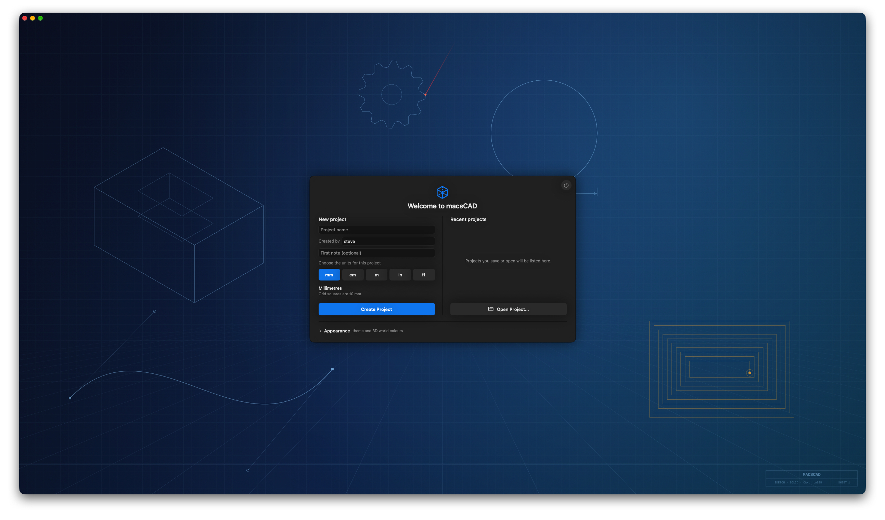

# macsCAD
Welcome to MacsCAD

As you have probably noticed, when it comes to Computer Aided Design on a Mac your options are limited in some ways, particularly as a hobbyist.  There is FreeCAD with its unfathomable interface, Fusion 360 which limits you to a handful of projects, and then there is OnShape.  The problem with the last two is that you are essentially at the mercy of your internet connection.  Broadband goes down, no OnShape, connection not working, Fusion is a pain.  What if there was another alternative, built from the ground up in Swift, for Macs only, with a feature set that should cost you hundreds, if not thousands.  So what does this elusive software bring to the table that makes it worth your hand earned money...  Here is a taster.

* 2d sketching with all the usual shapes and constraints
* advanced 2d features:  fully parametric modelling, linear and radial patterning across three dimensions, 
* 3d workspace with tools such as extrude, cut, join, holes etc.
* advanced 3d functions:  sketches on planes (Here is looking at you FreeCAD), off set planes, shells, positive, negatve and symetrical extrusion.  Assignment of true physical properies, not just appearances.  So if you want a part made out titanium, it knows roughly what its physical properties are.  Shear and twist functionality.  Components and exploded views.
* Very advanced feature include load application and stress visualisation along with simulated damage.
* Multiple view planes as well as custom planes, even planes at an angle.
* CAM support, with GRBL, Mach3 and other high end post-processors.
* CAM supports adaptive, roughing, pocketing, contours and other expected tool-paths.
* CAM supports simulated CNC machines so you do not have to break your expensive bit - also has extensive mill bit library support as well as in-built feeds and speeds calculator.
* CAM supports v-carving and height map engraving.
* LASER support using gcode with cut, engrave and fill.
* Tools include the bit library, speeds calculator, physics simulation, for example, motion and drop testing.  If nothing else it is fun to see what happens when titanium hits a piece of glass as you watch it shatter into pieces (the more powerful your Mac the better for this as it is computationally expensive.

